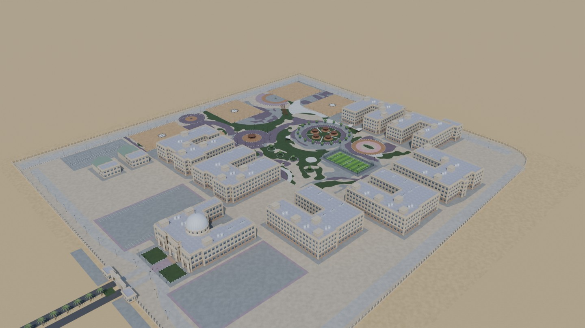

# EPNU 3D: East Port Said National University campus model

**جامعة شرق بورسعيد الأهلية: نموذج ثلاثي الأبعاد ودليل تفاعلي للحرم الجامعي**

This is an evidence-based 3D reconstruction of the East Port Said National University (E.P.N.U) campus in Salam Misr El-Gedida, East Port Said, Egypt. It comes with an interactive Three.js campus guide intended for the university website.

How the model was made:
- Building footprints come from OpenStreetMap and were checked against 2022 satellite imagery.
- Building heights and the plaza layout come from COLMAP photogrammetry of the supplied campus video.
- The architecture was modelled procedurally in Blender.

It is a reconstruction, **not a survey**. See [`deliverables/reconstruction_report.md`](deliverables/reconstruction_report.md) for accuracy figures and what is verified, estimated or unknown.



## Quick start: run the web viewer
```bash
cd viewer                 # deliverables/web_viewer/ is an identical, deployable copy
python3 serve.py 8080     # any static file server works
# open http://localhost:8080/
```
- The viewer has no build step and no CDN. Three.js r186 is included in `viewer/lib/three/` and pdf.js 4.10 in `viewer/lib/pdfjs/`. The only external service is the optional midterm API storage (see «Midterm exams» below).
- It must be served over HTTP; opening it as a `file://` page will not work.
- Use `?quality=lite` or `?quality=high` to force a model variant.
- Use `#bld_main` (or any other building ID) to open the viewer with that building selected.

### Timetables (الجداول)
The viewer opens with an Arabic timetable panel (`viewer/js/schedule.js`). Students pick their level and section, see their next class, and press **وديني** to get walking directions to the room.

- **Data:** the Computer Science timetable is in `viewer/data/schedules/fall-2026.json`.
- **Upload a new timetable:** press **رفع جدول** and choose a CSV or JSON file. **تنزيل CSV** downloads the current timetable in the same format, ready to edit in Excel.
- **CSV columns:** `level, day, period, course, type, group, sections, room, building`. Arabic headers and day names work too.
  - `sections` takes `1:5` (sections 1 to 5) or `3,4`.
  - `room` can be written as in the printed tables, for example `Hall:3`, `Drawing Hall 3`, `Room:104`, `Lab 2` or `قاعة 1`.
- **Linking:** each class is linked automatically to its building, and to the room when the indoor map has it (`viewer/data/room_index.json`). The panel shows how many classes are linked.
- **Storage:** an uploaded timetable is kept in that browser only. **الجدول الأصلي** goes back to the built-in one.

### Midterm exams: TA uploads and «اعرف لجنتك»
The **الميدترم** tab is filled by the TAs (المعيدين), not by local uploads. Students type their university ID and get the room of each of their exams, with **وديني** to walk there.

- **TA page:** `admin.html` (the **رفع (للمعيدين)** button in the midterm tab opens it). It is protected by one shared TA password that is checked on the server.
  1. Pick the level (سنة أولى → رابعة).
  2. **جدول الامتحانات:** upload the exam timetable as Word (.docx), PDF, Excel (.xlsx) or CSV. The expected layout is the printed one: time slots across the top, one row per day with its date, and `Course | CODE` in the cells. Review the rows, fix anything wrong, then press **نشر**.
  3. **كشوف القاعات:** upload the UNIHUB room sheets (PDF, one room per page). Several files can go in at once. Excel or CSV with an `ID` column (and optionally a room column) also works. Each sheet shows its course, date, time and room, and whether the room is on the 3D map. Pick the room from the list if it is not linked, then press **نشر**. Re-uploading the same exam and room replaces the old sheet.
  4. **جرّب كود طالب:** check what a student will see for an ID.
- **Reading files:** files are read in the browser (`viewer/js/midterm-parse.js`, with pdf.js in `viewer/lib/pdfjs/`). Scanned PDFs and photos have no text and are rejected, so ask for the original file. Old `.doc` and `.xls` must be saved as `.docx` / `.xlsx` first.
- **API:** Vercel Functions in `viewer/api/`.
  - `GET /api/midterm` returns every level's exams and the rooms used.
  - `GET /api/midterm?id=…` returns one student's exams and rooms, plus their first name only.
  - `POST /api/admin` handles the TA actions and needs the password token.
  - Full names stay on the admin side. ID lookups are rate-limited per IP.
- **Vercel setup (once):**
  1. The project's **Root Directory** must be `viewer`.
  2. Under Storage / Marketplace, add **Upstash for Redis** and connect it to the project. This sets `KV_REST_API_URL` and `KV_REST_API_TOKEN`.
  3. Run `node pipeline/hash_admin_password.mjs "<TA password>"` and add the printed `ADMIN_PASSWORD_HASH` under Settings → Environment Variables.
  4. Redeploy.

  Until this is done, the site keeps working and the midterm tab shows the built-in placeholder.
- **Local run with the API:** `cd viewer && node dev-server.mjs 8090`, then open `http://localhost:8090/` and `/admin.html`. Put `ADMIN_PASSWORD_HASH=…` in `viewer/.env.local`. Data is kept in `viewer/.data/`; both of these are git-ignored. `python3 serve.py` still works, but without the midterm API.
- **Checking the file readers:** `node pipeline/test_midterm.mjs <files…>` prints what is read from each file (a file name containing "schedule" / "midterm" is read as a timetable, anything else as room sheets).

Website integration options (iframe or native page) and server settings are in [`deliverables/README.md`](deliverables/README.md#website-integration).

## Architecture overview & 3D Engineering Building realism

Both **Engineering Building 1** (`bld_e2`, 100 rooms across 4 storeys `G, 1, 2, 3`) and **Engineering Building 2** (`bld_e1`, 72 rooms across 4 storeys `G, 1, 2, 3`) ship as complete, collision-safe architectural interiors with **100% coverage of all 114 scheduled courses** in `viewer/data/schedules/fall-2026.json`:

| Module | Responsibility |
|---|---|
| `viewer/js/walker.js` | **Articulated student rig (`1.75 m`)** — 15-joint human hierarchy (`pelvis`, `spine`, `neck`, `head`, `backpack`, `shoulder-L/R`, `elbow-L/R`, `hip-L/R`, `knee-L/R`, `ankle-L/R`, `sole-L/R`). Gait phase is strictly locked to physical world distance (`dPhase ∝ ds / strideLength`) with closed-form sole kinematics guaranteeing exact `0.000 m` foot contact on ground and stair treads, zero foot sliding while walking or paused, and dedicated knee/hip lift biomechanics during stair climbs (`stairBlend`). |
| `viewer/js/interior.js` | **PBR university architecture & `InstancedMesh` batcher** — full floor-to-ceiling plaster partitions with travertine stone dado rails & walnut trim (`0.00 m` ceiling gap), acoustic grid soffit ceilings with flush LED luminaires and shaft cutouts, structural reinforced-concrete columns strictly bounded per storey (`clearH`) so upper-floor columns never leak into lower storeys, brushed stainless elevator lobbies, and true stepped concrete switchback staircases (`buildStaircase` / `stairProfile`) with stringers, risers, treads, aluminum nosing strips, landings, balusters, and steel handrails. |
| `viewer/js/furniture.js` | **Procedural academic room furnishings & doorways** — instanced lecture hall tiered seating, stages & whiteboards, classroom student desks, computer lab workstations with monitors, engineering drawing drafting tables, faculty offices, reception counters, cafeteria tables, rest lounge seating, WCs, double-leaf oak doors with vision panels & handles, and stairwell floor nameplates (`floor-door`). |
| `viewer/js/route.js` | **Collision-free multi-floor path planner** — grounds entrance thresholds (`door` segments), solves obstacle-inflated `0.5 m` 2D A* corridor paths with visibility string-pulling, emits explicit `stair_approach` and `landing` portal waypoints, traces real switchback stair treads step by step (`max Δy = 0.225 m`), routes cleanly through open room doorways, and scopes destination highlights strictly to the active floor. |
| `viewer/js/tour.js` | **Deterministic state machine & human eye-level camera (`~1.62 m`)** — monotonic segment sweep (`IDLE → ROUTE_PLANNING → WALKING → ENTERING_DOOR → CORRIDOR_NAVIGATION → APPROACHING_STAIRS → CLIMBING → FLOOR_LANDING → ARRIVED`) with authoritative landing verification before incrementing `floor`, smooth horizontal eye-level follow camera (`pitch ≈ -2°`), 3D raycast wall/ceiling clamping, and analytical stairwell shaft containment. |
| `viewer/js/voice.js` | **Egyptian Arabic voice guidance** — pre-rendered MP3 cues (`viewer/audio/cues/`) with Web Speech API + `espeak-ng` `/__tts` HTTP/1.1 fallback, one concise announcement per route leg, independent speed & mute controls. |

## Realistic navigation & Arabic voice guidance (وديني)

Selecting **وديني** in the timetable panel starts a guided walk to the room through the real layout:

- **Building-only interior view at human eye level (`~1.62 m`)** — outdoors the camera follows smoothly behind the student with surrounding campus buildings framed clearly. Upon crossing the entrance doorway (`ENTERING_DOOR`), the exterior campus and route spline hide automatically, indoor near-plane clipping adjusts cleanly (`near = 0.2 m`), and the camera tracks horizontally behind the student at human standing eye height (`~1.62 m`) with full wall, ceiling, and stairwell shaft collision protection. Leaving or cancelling restores the whole campus.
- **Authoritative progressive staircase traversal** — each storey climbs one switchback lane to a half-landing, reverses direction, and climbs the opposite flight tread by tread (`max Δy = 0.225 m`) floor by floor (`G → 1 → 2 → 3`). Logical floor state updates **only after** completing corridor approach, ascending every tread of the flight, and reaching the verified upper landing (`FLOOR_LANDING`). Intermediate corridors remain untouched during multi-floor climbs, and upper-floor geometry above the active ceiling remains strictly occluded (`floors[3].group.visible === false` on Floor 2).
- **Navigation state machine** — explicit states (`IDLE → ROUTE_PLANNING → WALKING → ENTERING_DOOR → CORRIDOR_NAVIGATION → APPROACHING_STAIRS → CLIMBING → FLOOR_LANDING → ARRIVED`) drive the live Arabic status badge, voice cues, and camera behavior; pause, resume, replay, skip, minimize (`–`), mute (`🔊/🔇`), and movement speed (`1× / 1.5× / 2×`) work cleanly at any point.
- **Arabic voice guidance** — one concise Egyptian-colloquial instruction per route leg («صباح الخير يا هندسة. عدّي البوابة الرئيسية…», «ادخل، واطلع من السلم اللي على اليمين لحد الدور التالت على طول.», «انت كده في الدور التالت. خش يمين، هتلاقي قاعة 3.», «وصلت بالسلامة.»).

### Automated verification & visual QA suites

Run the HTTP/1.1 server and execute all three Playwright + WebGL verification suites:

```bash
python3 viewer/serve.py 8080 &
python3 pipeline/smoke_viewer.py http://127.0.0.1:8080/             # 10/10 desktop + mobile smoke checks
python3 pipeline/qa_engineering_realism.py http://127.0.0.1:8080/   # 16/16 rig, architecture, camera, occlusion & 114/114 timetable checks
python3 pipeline/qa_navigation.py http://127.0.0.1:8080/            # 28/28 multi-floor switchback stairs, state machine & Arabic voice checks
```

Latest verified run: **54/54 checks passed (`10/10` + `16/16` + `28/28`), `0` console errors, `0` failed HTTP requests**, with full visual before/after proof plates in [`deliverables/qa/comparison/`](deliverables/qa/comparison/) and rendered step captures in [`deliverables/qa/realism/`](deliverables/qa/realism/) and [`deliverables/qa/nav/`](deliverables/qa/nav/).

Known limitations: the indoor map is indicative (see the notes in `data/`), and spoken Arabic requires
Arabic voices installed on the device (Windows/Android/ChromeOS ship them; otherwise the visual guidance
still works).

## Repository layout

| Path | Contents |
|---|---|
| [`deliverables/`](deliverables/) | Final outputs, documented in [`deliverables/README.md`](deliverables/README.md):<br>• `campus_model.glb` (1.15 MB) and `campus_model_mobile.glb` (0.72 MB)<br>• `campus_model.blend` (Blender 4.5)<br>• `textures/` and preview `renders/`<br>• `web_viewer/` and browser `qa/` results<br>• photogrammetry products<br>• the reconstruction report and source analysis |
| [`viewer/`](viewer/) | Working copy of the web viewer: HTML, CSS and JS, models, `data/buildings.json`, and three.js in `lib/three/`. |
| [`pipeline/`](pipeline/) | Python and Blender scripts that rebuild textures, the site plan, the `.blend`, both GLBs, the renders and the browser QA. |
| [`data/`](data/) | Inputs in local metres: stable building IDs with info-panel text, OSM footprints and roads, site layout, sampled colour palette and model statistics. |
| [`analysis/`](analysis/) | Photogrammetric orthophoto, ground classification, site-plan overlays and the Phase-1 [`source_analysis.md`](analysis/source_analysis.md). |
| [`photogrammetry_test/`](photogrammetry_test/) | COLMAP run scripts. |
| [`sources/`](sources/) | The reference photo supplied with the brief. |

**Not included in this repository:**
- The source video: it is too large for git and remains in the original Google Drive folder.
- The intermediate photogrammetry frames.
- The packaged ZIP: `pipeline/package_deliverables.py` rebuilds it.

## Rebuilding
- **Requirements:** Blender 4.5 LTS and Python 3 with numpy, scipy, Pillow and opencv-python-headless. Playwright is needed only for browser QA, and COLMAP 3.10 only to redo the photogrammetry.
- **Commands:** the full rebuild order is in [`deliverables/README.md`](deliverables/README.md#rebuilding--extending-the-model).
- **Paths:** the scripts expect the project at `/home/user/campus_project/`. If you clone it somewhere else, edit the `ROOT` constant at the top of each script.

## Status and limitations
- **IDs are not official names.** Building codes such as `bld_w1` and `bld_s2` are stable model identifiers.
- **Unconfirmed mapping.** The faculty in each building, and which buildings carry the sign letters B, H and I, could not be confirmed from the sources. Add them in `data/buildings.json` once the university confirms them; the viewer picks up the changes automatically.
- **Approximated parts.** Sides not visible in the sources and the soft landscaping are conservative approximations.
- **Testing.** Browser QA ran on headless Chromium with software WebGL (22/22 checks passed). It has not been tested on real GPUs, iOS or physical phones.

## Attribution and licences
- Building footprints and roads: © OpenStreetMap contributors, ODbL 1.0. Attribution is required wherever the model is shown; the viewer footer includes it.
- Satellite imagery (reference only): Esri World Imagery, Vantor/Maxar WorldView-3, 2022-08-08.
- Source video and photo: supplied for this project. The video carries a "WITTY MEDIA" watermark, and its frames were used for analysis.
- Three.js: MIT licence ([`viewer/lib/three/LICENSE`](viewer/lib/three/LICENSE)).
- No licence has been chosen for this project's own code and models yet, so all rights are reserved by default. Choose one before making the repository public.
